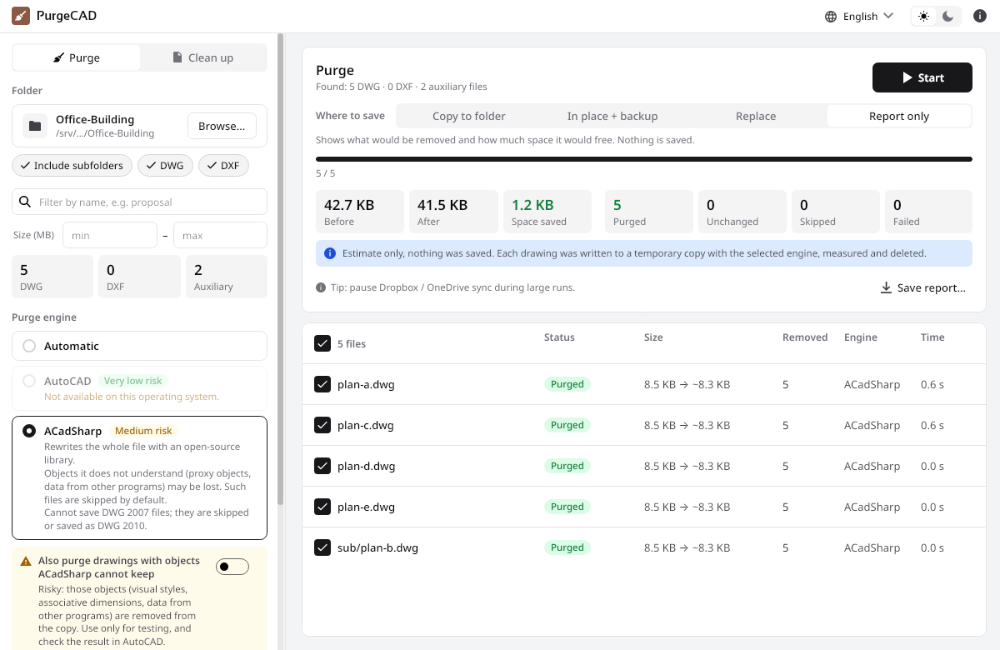

<h1 align="center">
  
  &nbsp;PurgeCAD
</h1>

<p align="center">
  <b>Purge every drawing in a folder, in one go.</b><br>
  Removes everything unused from your DWG and DXF files, and cleans up the files CAD programs leave behind.<br>
  Free and open source. No account, no ads, no telemetry.
</p>

<p align="center">
  <a href="https://github.com/SyntelabHQ/purge-cad/releases/latest"></a>
  &nbsp;&nbsp;
  <a href="LICENSE"></a>
  &nbsp;&nbsp;
  <a href="https://github.com/SyntelabHQ/purge-cad/releases"></a>
  &nbsp;&nbsp;
  <a href="https://syntelab.com/apps/purge-cad"></a>
</p>

<p align="center">
  <a href="#%EF%B8%8F-download">Download</a> ·
  <a href="#-what-it-does">What it does</a> ·
  <a href="#-why-purgecad">Why</a> ·
  <a href="#-help-the-project">Help the project</a> ·
  <a href="#-feedback">Feedback</a>
</p>

<p align="center">
  <picture>
    <source media="(prefers-color-scheme: dark)" srcset="docs/readme/screenshot-dark.png">
    
  </picture>
</p>

## ⬇️ Download

<table>
  <tr>
    <th width="33%"><br>Windows</th>
    <th width="33%"><br>Linux</th>
    <th width="33%"><br>macOS</th>
  </tr>
  <tr>
    <td align="center" valign="middle">
      <br>
      <a href="https://github.com/SyntelabHQ/purge-cad/releases/latest/download/PurgeCAD-win-Setup.exe"></a>
      <br><sub>Windows 10 and 11 · installer <code>.exe</code> · no administrator rights needed</sub>
      <br><br>
      <a href="https://github.com/SyntelabHQ/purge-cad/releases/latest/download/PurgeCAD-win-Portable.zip"></a>
      <br><br>
    </td>
    <td align="center" valign="middle">
      <br>
      <a href="https://github.com/SyntelabHQ/purge-cad/releases/latest"></a>
      <br><sub>x64 · <code>.AppImage</code>, runs on any distribution</sub>
      <br><br>
    </td>
    <td align="center" valign="middle">
      <br>
      <a href="https://github.com/SyntelabHQ/purge-cad/releases/latest"></a>
      <br><sub>Apple Silicon and Intel</sub>
      <br><br>
    </td>
  </tr>
</table>

<p align="center"><sub>All versions and release notes: <a href="https://github.com/SyntelabHQ/purge-cad/releases">Releases</a> · <a href="https://syntelab.com/apps/purge-cad">syntelab.com/apps/purge-cad</a></sub></p>

> [!NOTE]
> The Linux and macOS builds are made from the same code but **have not been tested yet**. If something does not work, please [open an issue](https://github.com/SyntelabHQ/purge-cad/issues) and we will fix it.
> The builds are not signed yet. On Windows, SmartScreen may warn on the first run: choose **More info › Run anyway**. On macOS, right-click the app and choose **Open** the first time.

## 🧩 What it does

<table>
  <tr>
    <td width="50%" valign="top">
      <h3>🧹 Purge a whole folder</h3>
      <p><b>Every DWG and DXF drawing, subfolders included.</b></p>
      <p>Removes unused blocks, layers, linetypes, text, dimension, table, multileader and multiline styles, materials, view styles, registered applications, layer filters, DGN linetype components and annotation scales. It repeats until nothing more can go. Filter the files by name or size, and untick the ones to leave alone.</p>
    </td>
    <td width="50%" valign="top">
      <h3>⚙️ Two engines</h3>
      <p><b>AutoCAD when you have it, an open-source library when you don't.</b></p>
      <p>With full AutoCAD on Windows, AutoCAD itself purges and saves the files: very low risk. Without it, ACadSharp does the work on any system, with safeguards on: drawings with objects it does not understand are skipped, and every file is checked before it replaces the original. Each engine shows its risk before you start.</p>
    </td>
  </tr>
  <tr>
    <td width="50%" valign="top">
      <h3>🛡️ Safe by default</h3>
      <p><b>You choose what happens to the originals.</b></p>
      <p>Save purged copies to another folder, purge in place with a backup, replace the files, or just see a report: what would be removed and how much space it would free, without saving anything.</p>
    </td>
    <td width="50%" valign="top">
      <h3>📊 See what changed</h3>
      <p><b>Every file, with its result.</b></p>
      <p>Size before and after, space saved, what was removed, which engine did it and how long it took. Files that were skipped say why. Save it all as a CSV report.</p>
    </td>
  </tr>
  <tr>
    <td width="50%" valign="top">
      <h3>🗑️ Clean up leftovers</h3>
      <p><b>The files CAD programs leave behind.</b></p>
      <p>Lock files (<code>.dwl</code>, <code>.dwl2</code>), backups (<code>.bak</code>) and autosaves (<code>.sv$</code>), as part of a purge or on their own. You see the list first, and they go to the Recycle Bin / Trash unless you choose otherwise.</p>
    </td>
    <td width="50%" valign="top">
      <h3>🚀 Made for big folders</h3>
      <p><b>Thousands of drawings stay fast.</b></p>
      <p>The folder is counted as soon as you pick it, up to four drawings are purged at a time, and the list of results stays quick with tens of thousands of files. Stop at any moment: the file in progress is never left half-written.</p>
    </td>
  </tr>
</table>

## ✨ Why PurgeCAD

<table>
  <tr>
    <td width="33%" valign="top">
      <h3>🔒 Private by design</h3>
      <p>Your drawings never leave your computer. No account, no sign-in, no telemetry. The program goes online only to check for a new version, and you can turn that off.</p>
    </td>
    <td width="33%" valign="top">
      <h3>♾️ No limits</h3>
      <p>No file counts, no size caps, no paid tiers. A folder of ten drawings or a whole archive: the only limit is your hardware.</p>
    </td>
    <td width="33%" valign="top">
      <h3>🧭 Clear about risks</h3>
      <p>Each engine says what it can and cannot do before you start, and nothing is overwritten unless you choose it.</p>
    </td>
  </tr>
  <tr>
    <td width="33%" valign="top">
      <h3>🔄 One-click updates</h3>
      <p>Installed with the setup, PurgeCAD tells you when a new version is out and installs it with one click. Your settings are kept.</p>
    </td>
    <td width="33%" valign="top">
      <h3>🌍 62 languages</h3>
      <p>The whole interface is translated, light and dark themes included. Full right-to-left (RTL) support: in Arabic, Hebrew, Persian and Urdu the interface is mirrored.</p>
    </td>
    <td width="33%" valign="top">
      <h3>📖 Open source</h3>
      <p>The code is public under the GNU GPL v3: anyone can read it, check what it does and build it themselves.</p>
    </td>
  </tr>
</table>

## 🤝 Help the project

PurgeCAD is open source, and it gets better with every pair of eyes on it. If you like it, here is how you can help:

- 💻 **Read the code and propose changes.** Look at how something is built, find what can be done better, and send a pull request. For a larger change, open an issue first so we can talk about it. The ground rules are in [CONTRIBUTING.md](CONTRIBUTING.md).
- 🐞 **Report bugs.** [Open an issue](https://github.com/SyntelabHQ/purge-cad/issues) with the steps to see it, your system, the engine you used and the version of the program. Please do not attach drawings you are not allowed to share.
- 🌍 **Improve a translation.** The texts are in `src/PurgeCad.Localization/Strings/`; `en.json` is the source, every other language follows it. See [docs/LOCALIZATION.md](docs/LOCALIZATION.md).
- ❤️ **Support us.** The program is free, and keeping it that way takes time. A donation, one-time or monthly, helps: [syntelab.com/support](https://syntelab.com/support).
- 📣 **Tell others.** A star on this repository or a recommendation to a colleague helps more people find it.

By sending a contribution you agree that it is published under the same license, the [GNU GPL v3](LICENSE) with the [additional terms](ADDITIONAL-TERMS.md).

<details open>
<summary><b>Build from source</b></summary>

You need the [.NET 10 SDK](https://dotnet.microsoft.com/download). The program builds and runs on Windows, macOS and Linux; the AutoCAD engine works only on Windows with full AutoCAD installed.

```bash
git clone https://github.com/SyntelabHQ/purge-cad.git
cd purge-cad
dotnet run --project src/PurgeCad.App    # run the program while you work on it
dotnet test                              # tests
```

To build the Windows installer, run `.\build\release-windows.ps1` in PowerShell; the files land in `artifacts\releases`. Releases are described in [docs/RELEASING.md](docs/RELEASING.md), the design in [docs/SPEC.md](docs/SPEC.md).

</details>

## 💬 Feedback

Ideas, bugs, opinions: we read all of them.
Open an [issue](https://github.com/SyntelabHQ/purge-cad/issues), send a pull request, or write to us through the [feedback form](https://syntelab.com/feedback).

## 🧱 Built with

PurgeCAD stands on the work of many open source projects. Thank you to all of them. The main ones:

| Project | What it does in PurgeCAD |
|---|---|
| [ACadSharp](https://github.com/DomCR/ACadSharp) | Reading and writing DWG and DXF files, for the engine that works without AutoCAD |
| [Avalonia](https://avaloniaui.net) | The program window and the interface, the same on Windows, macOS and Linux |
| [CommunityToolkit.Mvvm](https://github.com/CommunityToolkit/dotnet) | The link between the interface and the program logic |
| [Velopack](https://velopack.io) | The installer and the one-click updates |
| [Noto Sans](https://fonts.google.com/noto), [Sansation](https://fonts.google.com/specimen/Sansation) and [Font Awesome Free](https://fontawesome.com) | Fonts and the app icon |

The AutoCAD engine uses your own AutoCAD installation; no Autodesk software is shipped with PurgeCAD.
The full list, with the license of each part, is in [NOTICE.md](NOTICE.md).

## 📜 License

PurgeCAD is free software under the [GNU GPL v3](LICENSE), with the additional terms in [ADDITIONAL-TERMS.md](ADDITIONAL-TERMS.md).
It comes with no warranty: keep backups of your drawings and check the results before you rely on them.

**You can** use it for anything, including at work and commercially, study the code, change it, and share it, as it is or changed.

**In return**, when you share it or a version based on it:

- 🏷️ **Credit us.** Keep this notice in the About window and in the documentation:
  > Based on PurgeCAD by Syntelab — https://syntelab.com/apps/purge-cad
  > Part of Syntelab Apps — https://syntelab.com/apps
- 📂 **Keep it open.** Publish your version under the same license, with its source code.
- ✏️ **Use a name of your own.** The names "PurgeCAD", "Syntelab" and "Syntelab Apps" and their logos stay ours; a changed version needs its own name and icon. See [TRADEMARKS.md](TRADEMARKS.md).

AutoCAD is a registered trademark of Autodesk, Inc. PurgeCAD is not affiliated with Autodesk.

<p align="center">Made by <a href="https://syntelab.com">Syntelab</a>, a creative tech studio.</p>
